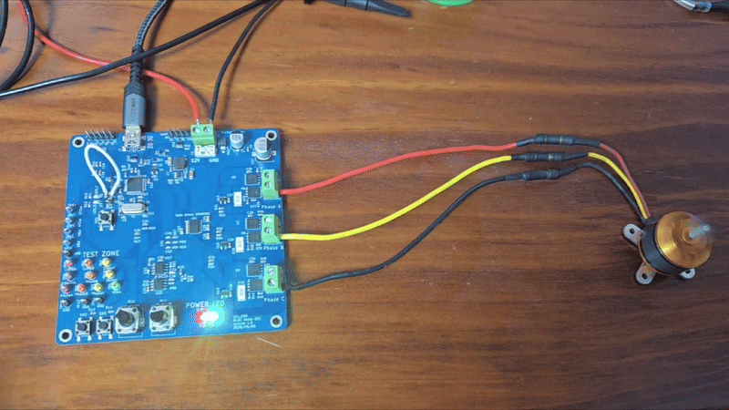
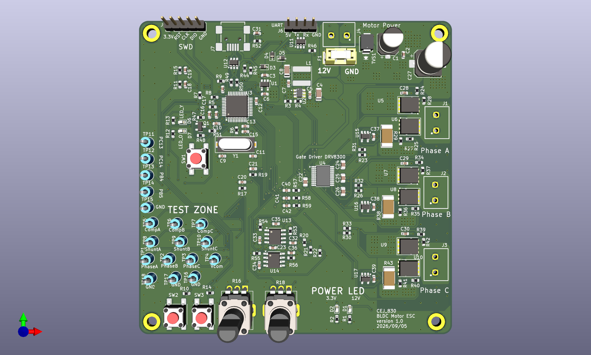
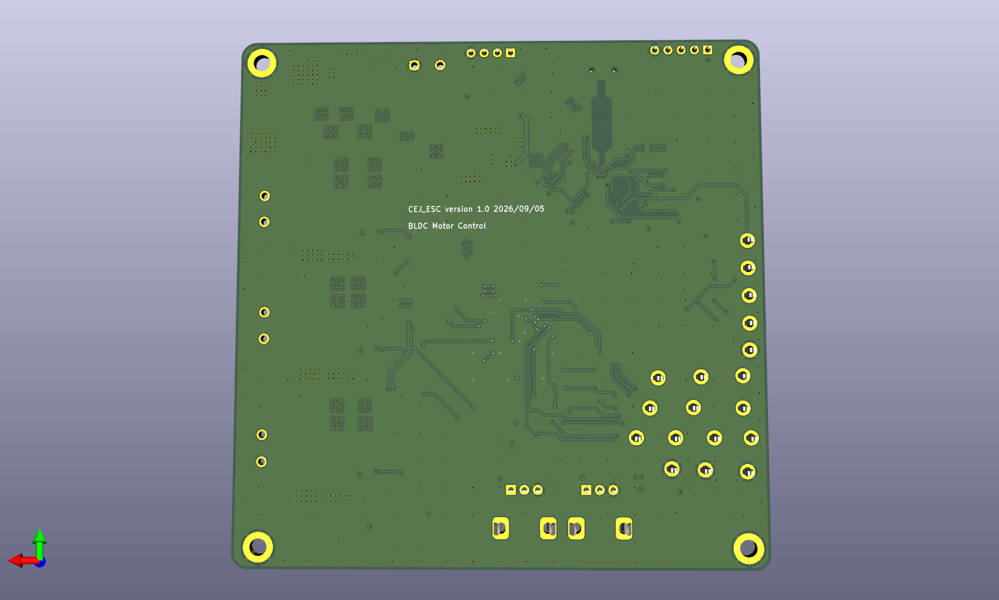
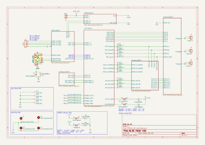
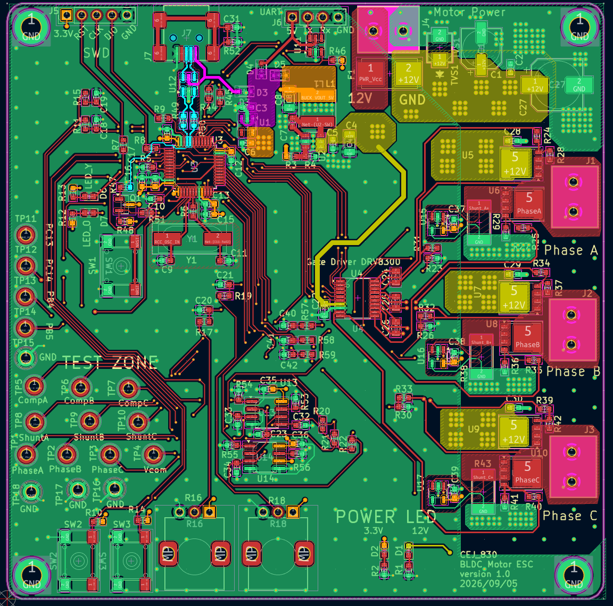
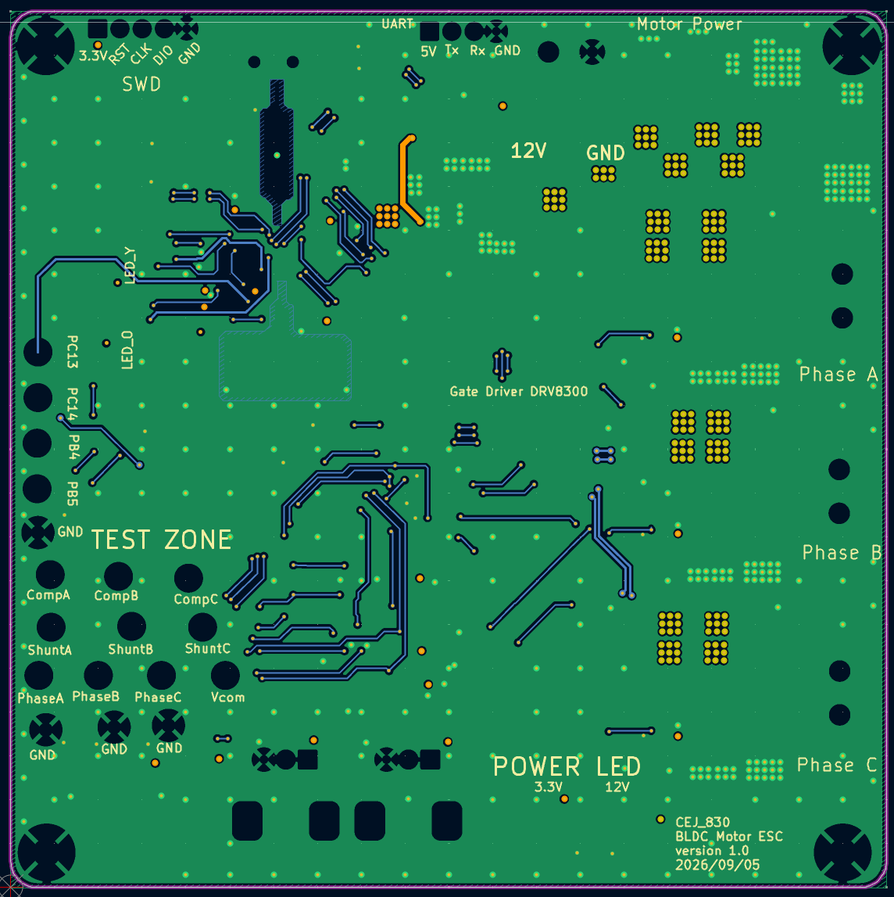
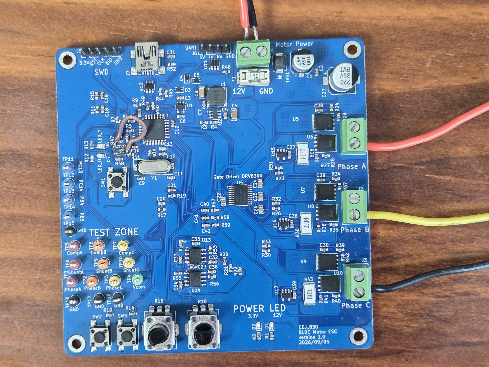
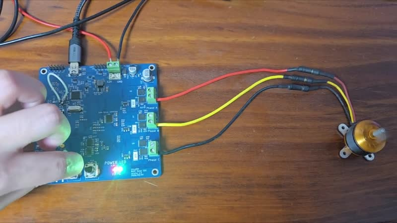

# STM32 Sensorless BLDC ESC

STM32F103C8 기반 센서리스 BLDC ESC. 회로·4-layer PCB 설계 및 펌웨어 구현을 수행하고
12V에서 A2212/13T 1000kV 모터의 무부하 구동을 확인했다.

## Hardware

- **MCU:** STM32F103C8T6
- **Gate driver / MOSFET:** DRV8300 / IRFH7440 × 6
- **PCB:** 4-layer, 1.6mm
- **Power:** 12V→5V Buck, USB 5V와 diode ORing, 3.3V LDO
- **BEMF sensing:** 상전압 ADC 입력 및 TLV3202 외부 비교기
- **Current sensing:** 10mΩ 로우사이드 션트 및 INA180A3 × 3
- **Interface:** USB 2.0 FullSpeed, UART, LED, 버튼, 가변저항, 테스트 포인트

회로,BOM 작성, PCB 부품 배치 및 배선, 보드 bring-up을 직접 수행했다. 부품 실장은 SMT 조립을 외주하였다.

### 3D Board View

  
  

### Schematic

  

### PCB Layout — Front / Back

  
  

### Assembled Board

실물 수정: USB 풀업 저항 직결, Vcom 비교기 입력 커패시터 제거.

[하드웨어 구성 상세](docs/portfolio/architecture.md)

## Firmware

C, STM32 HAL 및 레지스터 제어로 구현한 인터럽트 기반 펌웨어. Open-loop 기동 후 BEMF 기반 six-step 정류로 전환

  

듀티 구간에 따라 ADC 기반 swBEMF·선형보간 또는 외부 비교기 출력의 TIM2 input capture로 ZC를 검출한다. TIM3로 다음 정류를 예약하고 TIM1 상보 PWM 출력을 갱신한다. 운전 데이터는 USB CDC로 전송한다.

[제어 코드](Core/Src/layer_1_Algorithm/algorithm_BLDC_Control.c) · [주변장치·정류표 상세](docs/portfolio/architecture.md)

## Testing

### Setup

- **Motor:** A2212/13T 1000kV
- **Supply:** 12V DC power supply
- **Load:** 무부하
- **Input:** 가변저항 ADC 값으로 CCR 조절
- **Observation:** 오실로스코프, USB CDC 모니터

### Results

#### Motor Operation

  

[구동 영상](Documents/ESC_activate_h264.mp4) — 무부하 운전 및 노브 조작.

| 항목 | 관찰 결과 |
| --- | --- |
| 속도 조절 | 노브 입력에 따른 CCR 및 회전 속도 변화 확인 |
| 최대 시험 설정 | ARR=1800, CCR=1750 — 설정 비율 약 97.2% |

#### PC Monitor

USB CDC 수신 데이터 표시 및 CSV 저장. RPM은 추정값이며, 션트 전류 환산값의 정확도는 미검증.

#### Oscilloscope

CH1: 스텝 GPIO · CH2: 플로팅 상 · CH3: Vcom · CH4: 비교기 출력.

각 행은 왼쪽 Step 1, 오른쪽 Step 2 파형으로 구성.

**저듀티 CCR 220**

  
  

**중듀티 CCR 700**

  
  

**고듀티 CCR 700 **

  
  

## Board Changes & Limitations

- **USB pull-up:** 제어 MOSFET 풋프린트 오류를 배선으로 수정하고 PA12 LOW 초기화 적용. 이후 USB 인식 회복 확인.
- **Comparator:** Vcom 커패시터 제거 후 고듀티에서 다중 에지 감소 관찰 및 input capture 경로 활용. ZC 정확도 개선량은 미검증.
- **Current / Operation:** 모터 발열 및 특정 CCR에서 거친 구동음 발생. 전류 측정 정확도, 부하 기동, 장시간 운전, 효율·정격·보호 성능은 미검증.
- **Hardware:** LDO 리플 감쇠 효과 및 USB 차동 임피던스 90Ω 설계 목표에 대한 실측 검증 미실시.
- **Comparison:** 동일 모터·전원에서 상용 ESC의 기동 반응이 더 빠른 것으로 정성 관찰. 동일 RPM의 전류·온도 비교는 미실시.

[개발 과정 및 디버깅 기록](docs/portfolio/development-story.md)

## Repository

| 위치 | 내용 |
| --- | --- |
| [Core](Core) | Driver / Algorithm / Service / Utility 및 헤더 |
| [Drivers](Drivers), [Middlewares](Middlewares), [USB_DEVICE](USB_DEVICE) | HAL·CMSIS, 미들웨어, USB 구성 |
| [CubeMX .ioc](BLDC_ESC_Based_On_HW_Test.ioc) | MCU 설정 |
| [ESC_Monitor](ESC_Monitor) | 수신·표시·CSV 저장 프로그램 |
| [Architecture](docs/portfolio/architecture.md) | HW/FW 구조와 제어 흐름 |
| [Development notes](docs/portfolio/development-story.md) | 개발 과정 및 디버깅 기록 |

**개발 환경:** STM32CubeIDE. 빌드·플래시 절차 및 KiCad 원본은 저장소에 미수록.

## References

- **ESC Development Board** — 하드웨어 설계에 참고한 오픈소스 프로젝트. 원본 저장소 URL 미기재.
- MCU 주변회로 학습 자료, 부품 데이터시트의 예제 회로·배치 지침, TI 평가보드 자료 — [출처 및 활용 범위](docs/portfolio/development-story.md).

*시험 바이너리와 현재 소스의 동일성은 미확인.*
