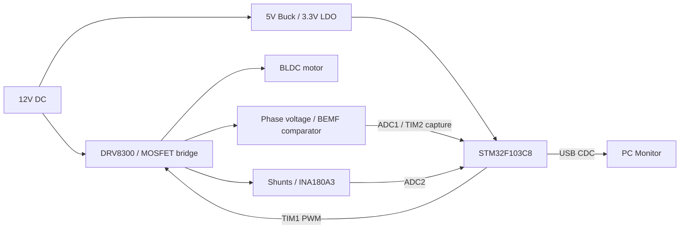

# STM32 Sensorless BLDC ESC

STM32F103C8 기반 3상 BLDC ESC — 회로 , 4-layer PCB 설계 , 센서리스 구동 펌웨어와 보드 bring-up까지 구현한 개인 프로젝트.

> **[대표 PCB 사진 / Demo Video 삽입 예정]** — 12V, A2212/13T 1000kV, 무부하 구동

## Key Highlights

- **Custom hardware:** 12V 입력, 5V/3.3V 전원, 게이트 드라이버·3상 인버터·센싱 회로를 4층 PCB에 통합.
- **Sensorless control:** open-loop 기동 후 BEMF ZC 기반 six-step commutation. ADC 선형보간과 외부 비교기 input capture 활용.
- **MCU peripherals:** TIM1 상보 PWM·ADC trigger, ADC1/2 injected conversion, TIM2 capture, TIM3 정류 예약, USB CDC 로그 전송.
- **Bring-up & debugging:** USB 풀업 경로 패치와 초기화 수정, Vcom 회로 수정 및 비교기 경로 활용으로 고듀티 구동 범위 확대.
- **Observed operation:** 12V 무부하에서 노브 속도 조절 및 ARR=1800 / CCR=1750까지 구동 관찰. 전류 계측·발열·부하 안정성은 검증 과제로 남음.

## System Overview

회로와 펌웨어가 연결되는 과정을 직접 구현하기 위해 개발했습니다. 초기 STM32F103RB 개발보드와 2층 인버터 시제품을 거쳐, 현재는 STM32F103C8 기반 통합 보드를 사용합니다.

| 항목 | 내용 |
| --- | --- |
| 개발 기간 / 도구 | 2026.01–10 / KiCad, STM32CubeIDE, C, HAL 및 레지스터 제어 |
| 직접 수행 | 회로·BOM, PCB 배치·배선, 펌웨어 구현·수정, 커넥터 납땜, bring-up, oscilloscope 관측·디버깅 |
| 외주 / 참고 | SMT 조립 외주. 데이터시트·평가보드·기존 제작 사례 참고, AI 개발 보조 활용 |
| 시험 환경 | 12V DC 전원, A2212/13T 1000kV, 무부하 |

## System Architecture

> **[Block diagram 이미지 삽입 자리]** — 필요 시 위 Mermaid를 신호명·측정점을 표시한 그림으로 교체

## Hardware

| 블록 | 구성 |
| --- | --- |
| MCU / PCB | STM32F103C8T6 / 4-layer, 1.6mm |
| 전원 | TPS560430 Buck: 12V → 5V / TPS7A2033 LDO: 5V → 3.3V |
| 인버터 | DRV8300, IRFH7440 MOSFET × 6 |
| BEMF sensing | 상전압 ADC 경로, TLV3202 외부 비교기 |
| Current sensing | 10mΩ 션트·INA180A3 × 3, ADC raw 취득; 전류 정확도 미검증 |
| Interface | USB, UART, 버튼, 가변저항, 테스트 포인트 |

> **[PCB 상·하면 / 핵심 회로도 삽입 예정]**

KiCad 원본은 별도 로컬 프로젝트에 있으며 저장소 추가 예정입니다. 실물의 USB 배선 패치·Vcom 커패시터 제거와 설계 파일의 일치 여부는 대조가 필요합니다. [회로 블록 상세](docs/portfolio/architecture.md)

## Firmware & Control Flow

1. **Startup:** 초기화·정렬 후 open-loop six-step 구동. 정류 간격이 6ms에 도달하면 폐루프로 전환합니다. 6ms는 전체 기동 시간이 아닙니다.
2. **Sampling:** TIM1 CH4에서 ADC trigger를 생성하고 상전압을 취득합니다. 정류 직후 blanking을 적용합니다.
3. **ZC detection:** 부동 상의 BEMF를 판정합니다. ADC 경로는 선형보간을, 비교기 경로는 TIM2 input capture를 활용합니다.
4. **Commutation:** ZC 간격에서 정류 지연을 계산·보정하여 TIM3에 예약하고 다음 스텝의 PWM·부동 상을 설정합니다.
5. **Telemetry:** 제어 처리에서 로그 큐에 기록하고 메인 루프에서 USB CDC로 전송합니다.

현재 PWM은 설정 기준 약 20kHz center-aligned complementary 방식입니다. `CLOSE_LOCKIN`에서 CCR 900을 기준으로 샘플링 위치를, CCR 1300을 기준으로 ADC/비교기 ZC 경로를 전환합니다. 이 값은 현재 구현 파라미터입니다.

Driver → Algorithm → Service 계층과 공통 Utility로 구성했습니다. [제어 코드](Core/Src/layer_1_Algorithm/algorithm_BLDC_Control.c) · [주변장치·상태·정류표 상세](docs/portfolio/architecture.md)

## Engineering Challenges

### 1. USB 인식 문제

- **Problem:** USB 풀업 연결이 정상 동작하지 않아 호스트 인식에 문제가 발생.
- **Analysis:** 풀업 제어 MOSFET의 풋프린트 적용 오류를 확인했다는 개발 기록. 핀·패드 대응 자료는 보완 예정.
- **Change:** MOSFET 제거·배선 패치, USB 초기화 전 PA12를 약 100ms LOW로 유지하는 처리 적용.
- **Result:** 적용 후 USB 인식 회복을 관찰. 하드웨어·펌웨어 변경 각각의 효과는 분리 검증하지 않음.

> **[USB 패치 전후 사진 / 해당 회로 삽입 예정]**

### 2. 고듀티 영역의 ZC 관측

- **Problem:** ADC 기반 고듀티 구동에서 ZC 검출에 어려움이 있었고 비교기에는 PWM에 동반된 다중 에지가 발생.
- **Analysis:** Vcom·상전압 입력의 충·방전 응답 차이와 ADC 취득 시점을 원인 후보로 판단. 원인별 기여는 미확정.
- **Change:** Vcom 측 커패시터를 탐색적으로 제거하고, 개선된 비교기 출력을 타이머 input capture로 활용.
- **Result:** 고듀티 에지가 비교적 단일하게 관찰되었고 CCR 1750까지 구동. ZC 오차의 정량 개선치는 미측정.

> **[Oscilloscope waveform 삽입 예정]** — 변경 전후 Vcom / 상전압 / 비교기 출력, 동일 조건·축 표시

[문제 해결 상세 및 개발 기록](docs/portfolio/development-story.md)

## Test Results

아래는 개발자의 시험 관찰·장비 표시값입니다. 대응 영상·파형·로그는 정리 중입니다.

| 항목 | 결과 | 근거 구분 |
| --- | --- | --- |
| 속도 조절 | 가변저항으로 CCR 변경 시 회전 속도 변화 | 동작 관찰, 외부 RPM 계측 없음 |
| 상단 구동 설정 | ARR=1800, CCR=1750 | 해당 설정에서 구동 관찰 |
| 설정 비율 | 1750/1800 ≈ 97.2% | 계산값, 게이트 ON 시간 실측 아님 |
| 연속 구동 | 시험한 최대 듀티에서 약 1분, 모터 발열 동반 | 개발자 관찰 |
| 입력 전류 | 위 조건에서 PSU 약 0.6A 표시 | PSU 표시값, 상전류·정밀 계측값 아님 |

> **[Monitor 화면 / 대표 로그 삽입 예정]** — 기록 시점, CCR, 관측 항목 표시

## Limitations & Future Work

- 션트 전류 측정의 신뢰성 미확보. 모터 발열과 특정 CCR의 거친 소리 원인 미확정.
- 부하 기동·장시간 운전·효율·정격 전류·보호 성능 미검증.
- 실물 패치와 회로도, 시험 당시 firmware와 저장소 버전의 대응 정리 필요.
- 후속 과제: 상용 ESC와 동일 전원·모터·RPM 조건에서 입력 전류와 온도 상승 비교. 아직 수행하지 않음.

## Repository Structure

| 경로 | 내용 |
| --- | --- |
| [Core/Src/layer_0_Driver](Core/Src/layer_0_Driver) | PWM, ADC, timer, UART 하드웨어 접근 |
| [Core/Src/layer_1_Algorithm](Core/Src/layer_1_Algorithm) | 기동·ZC 판정·정류 알고리즘 |
| [Core/Src/layer_2_Service](Core/Src/layer_2_Service) | 사용자 요청·운전 상태 관리 |
| [Core/Src/my_Utility](Core/Src/my_Utility), [Core/Inc](Core/Inc) | 시간·로그 유틸리티 및 헤더 |
| [Drivers](Drivers), [Middlewares](Middlewares), [USB_DEVICE](USB_DEVICE) | HAL/CMSIS, 미들웨어, USB 구성 |
| [CubeMX .ioc](BLDC_ESC_Based_On_HW_Test.ioc) | MCU 주변장치 설정 |
| [ESC_Monitor](ESC_Monitor) | Python 수신·표시·CSV 저장 프로그램 |
| [docs/portfolio/architecture.md](docs/portfolio/architecture.md) | HW/FW 구조 상세 |
| [docs/portfolio/development-story.md](docs/portfolio/development-story.md) | 문제 해결 상세·개발 회고 |
| [docs/portfolio/author-inputs.md](docs/portfolio/author-inputs.md) | 추가 자료·작성자 입력란·빌드 정보 |
| Hardware files | KiCad·회로도 PDF 추가 예정, 현재 저장소 미포함 |

## References

전원 IC 데이터시트의 예제 회로·배치 지침, TI 평가보드 자료, MCU 주변회로 및 BLDC 제작 자료를 참고했습니다. 정확한 서명·영상·보드명·URL은 [출처 입력란](docs/portfolio/author-inputs.md)에 추가 예정입니다. [자료별 활용 범위](docs/portfolio/development-story.md)

*문서 정리: 2026-10-18. 구현 설명은 로컬 소스 확인 기준이며 `462d3e0` 이후 미커밋 변경을 포함합니다. 시험 당시 바이너리와의 동일성은 미확인입니다.*
