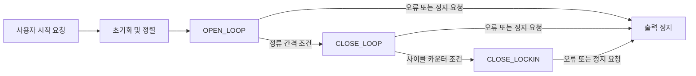

# 하드웨어·펌웨어 구조

## 하드웨어 블록

최상위 회로도 `STM32_ESC_HW.kicad_sch`는 다음 하위 시트를 참조한다.

| 시트 | 내용 |
| --- | --- |
| `power_block.kicad_sch` | 12V 5V 전환 Buck 컨버터, 다이오드 OR 회로, LDO 회로 |
| `mcu_block.kicad_sch` | STM32 MCU 주변 회로 |
| `inverter_block.kicad_sch` | 게이트 드라이버, MOSFET, 션트 |
| `sensing_block.kicad_sch` | BEMF 비교기와 션트 증폭, ADC 연결 |
| `interface_block.kicad_sch` | 가변저항, 스위치, LED  인터페이스 |
| `comm.kicad_sch` | USB,UART 관련 보호 및 신호 매칭 회로 |
| 

`STM32_ESC_HW.kicad_pcb`에는 F.Cu, In1.Cu, In2.Cu, B.Cu의 네 구리층과 1.6mm 두께가 정의되어 있습니다.

작성자는 실물에서 USB 풀업 제어 MOSFET을 제거하고 배선 패치를 했으며, Vcom 측 커패시터를 제거했다고 설명했습니다. 이 변경이 현재 KiCad 파일에 반영되어 있는지는 확인되지 않았습니다. 따라서 설계 파일을 그대로 제작하면 현재 실물과 같다고 볼 수 없습니다. 상세 내용은 [개발 기록](development-story.md)에 정리했습니다.

## 주변장치와 데이터 경로

| 주변장치 | 현재 소스에서 확인한 역할 | 근거 |
| --- | --- | --- |
| TIM1 | 3상 상보 PWM, center-aligned, PSC=0, ARR=1800; CH4 OC4REF로 ADC 트리거 | `main.c`, `driver_GateDriver.c` |
| ADC1 | injected rank 1–3에서 상전압 취득 | `main.c`, `driver_BLDC_HW.c` |
| ADC2 | injected rank 1–3에서 shunt A/B/C 취득; ADC1과 injected simultaneous 구성 | `main.c`, `driver_BLDC_HW.c` |
| TIM2 | 비교기 입력 캡처, 1µs 단위 설정 | `main.c`, 비교기·드라이버 코드 |
| TIM3 | 다음 정류 시점 예약 | `Driver_BLDC_HW_SetTimTrig()` |
| TIM4 | 비교기 경로 등의 정류 감시 타이머 | `Driver_WatchDog_Trigger()`, 제어 코드 |
| USB CDC | 메인 루프의 텔레메트리 배치 전송 | `utility_Log_BLDC.c` |

72MHz TIM1 클럭과 현재 설정 기준 PWM 주파수는 약 20kHz입니다. 파형 측정 결과는 별도로 추가합니다. TIM1에는 데드타임 설정이 있으나 실제 게이트 파형의 데드타임 검증은 이 문서 범위에 포함하지 않습니다.

## 서비스와 제어 상태

버튼 요청은 서비스 계층에서 시작·정지 상태로 처리합니다. 구동 알고리즘 내부의 주요 상태는 다음과 같습니다.

`CLOSE_LOCKIN`은 코드상의 상태 이름입니다. 이 이름만으로 모터의 안정성이나 정류 정확도가 검증되었다는 뜻은 아닙니다.

현재 개루프 정류 간격 설정은 10,000µs에서 시작하여 6,000µs까지 줄이는 형태이며, `LAST_OPEN_LOOP_DELAY=6000` 조건에서 폐루프로 전환합니다.

## 6-step 정류

| Step | PWM 공급 상 | 로우사이드 귀환 상 | 부동 상 / BEMF 관측 상 |
| --- | --- | --- | --- |
| 1 | A | B | C |
| 2 | A | C | B |
| 3 | B | C | A |
| 4 | B | A | C |
| 5 | C | A | B |
| 6 | C | B | A |

`sixstep()`에서 CCR과 출력 enable을 변경합니다. 부동 상은 해당 상의 메인·상보 출력을 비활성화합니다.

## BEMF 취득과 정류

ADC 경로에서는 스텝 상태와 타임스탬프를 저장하고, 정류 직후 blanking 조건을 확인한 다음 상전압과 션트 값을 취득합니다. BEMF 영교차 판정과 선형보간, 지연 계산을 거쳐 다음 정류 타이머를 설정하는 코드가 있습니다.

비교기 경로에서는 부동 상에 대응하는 TIM2 채널과 상승·하강 에지를 선택합니다. 코드에는 ADC 기반 ZC 시점과 비교기 캡처 시점을 함께 기록하는 필드도 있습니다.

현재 `CLOSE_LOCKIN` 코드의 조건:

- CCR 900 이상/미만에서 ADC 샘플링 위치를 전환합니다.
- CCR 1300 이상/미만에서 ZC 처리 소스를 비교기/ADC로 선택합니다.

이 값들은 현재 구현 파라미터입니다. 최적값이나 전 구간 안정성 검증 결과로 제시하지 않습니다. 제어 경로의 자세한 수식·임계값 선정 근거는 작성자 설명과 실험 자료를 확보한 뒤 추가합니다.

## 로그 출력 경계

현재 `MotorTelemetry_t`는 1바이트 패킹을 사용하는 27바이트 구조체이며, `tail` 앞에 shunt A/B/C의 `uint16_t` 필드가 있습니다. 로그 큐 배열은 64슬롯이고 full/empty 구분용 한 슬롯을 예약하는 구조입니다. 메인 루프는 USB 송신 가능 상태에서 최대 16패킷을 묶어 전송합니다.

PC 프로그램의 화면과 분석 결과는 이번 초안에서 별도 증빙으로 다루지 않습니다. 전류 값이 패킷에 존재하는 것과 측정 정확도가 검증된 것은 구분합니다.

## 핵심 소스

- [초기화·주변장치 설정·메인 루프](../../Core/Src/main.c)
- [구동 서비스](../../Core/Src/layer_2_Service/service_BLDC.c)
- [센서리스 제어 알고리즘](../../Core/Src/layer_1_Algorithm/algorithm_BLDC_Control.c)
- [비교기 처리](../../Core/Src/layer_1_Algorithm/algorithm_Comparator.c)
- [PWM·상 출력 제어](../../Core/Src/layer_0_Driver/driver_GateDriver.c)
- [ADC·타이머 하드웨어 접근](../../Core/Src/layer_0_Driver/driver_BLDC_HW.c)
- [텔레메트리 구조체](../../Core/Inc/my_Utility/utility_Log_BLDC.h)
- [로그 큐·USB 전송](../../Core/Src/my_Utility/utility_Log_BLDC.c)
