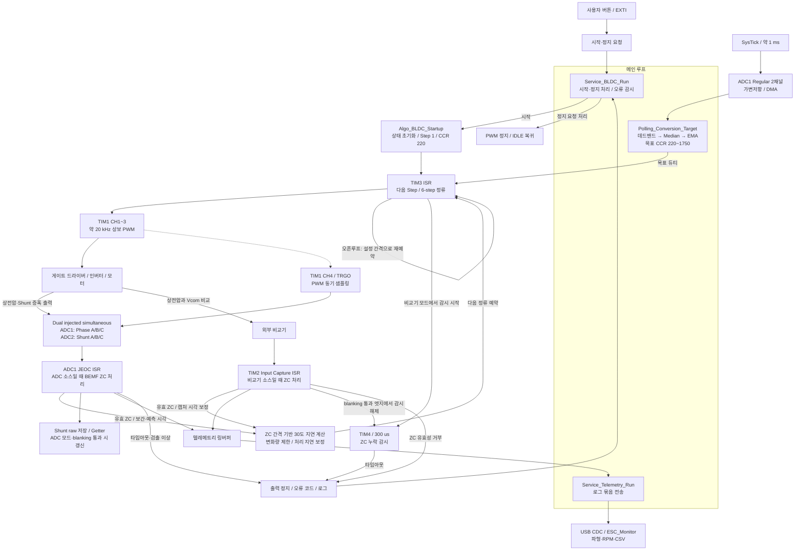
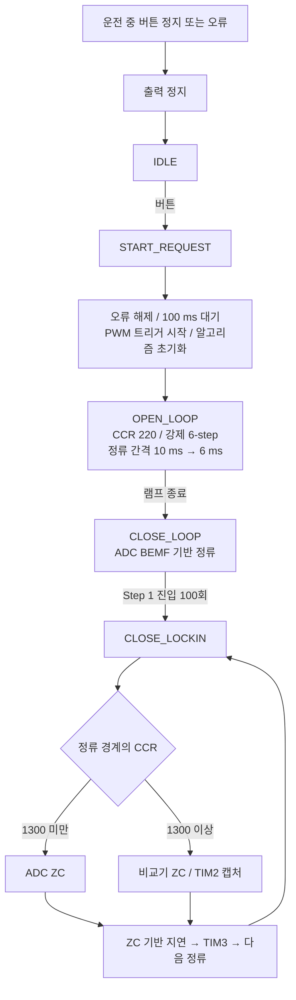
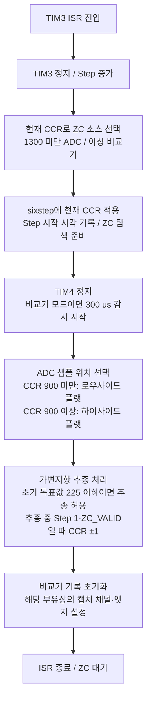

# ESC V1 펌웨어 동작 블록다이어그램

검토일: 2026-10-20. 기준: HEAD `3955bdf` 및 현재 작업 트리의 펌웨어 소스.
코드 구조를 설명하는 문서이며, 실기 성능이나 보호 동작 검증을 의미하지 않는다.

## 1. 전체 제어·데이터 흐름

화살표는 제어 요청 또는 데이터 흐름이다. 메인 루프는 세 서비스를 순차 실행하며 정류 계산은 인터럽트에서 수행한다.
TIM2는 1 us 타임베이스와 비교기 입력 캡처에 함께 사용된다.

## 2. 기동·운전 상태

서비스 상태와 알고리즘 상태는 별개이다. 서비스는 기동 요청 처리 후 `MOTOR_RUN_CLOSELOOP`를 사용하지만,
알고리즘은 그동안 `OPEN_LOOP → CLOSE_LOOP → CLOSE_LOCKIN`을 진행한다.
100 ms 대기는 `Algo_BLDC_Startup()`보다 앞에 있으므로 정렬 유지 시간으로 표현하지 않았다.

## 3. CLOSE_LOCKIN에서 TIM3 ISR의 실제 순서

현재 CCR 증감은 매 정류가 아니라 전기 1주기의 Step 1에서 수행한다.
`sixstep()` 이후 소프트웨어 CCR을 갱신하므로 변경값은 다음 정류에서 전달된다.
CCR preload에 기록한 값은 TIM1 업데이트 이벤트에서 실제 비교값으로 반영된다.

## 4. 구현 범위와 읽을 때 주의할 점

- BEMF = 부유상 전압 − (Phase A + Phase B + Phase C) / 3.
- ADC 입력은 Phase 3채널, Shunt 3채널이며 Vcom은 ADC injected 시퀀스에 포함하지 않는다.
- ADC 검출은 30 us blanking 후 진행한다. 정상 영교차는 선형 보간하고, 이미 지나간 영교차는 이전 기록을 이용한 보완 경로가 있다.
- ADC 탐색 타임아웃은 5 ms, 비교기 감시는 TIM4의 300 us 설정이다. 후자는 MCU 독립 watchdog이 아니다.
- 비교기는 CLOSE_LOCKIN의 ADC 소스 구간에서도 캡처 자료를 얻지만, 정류 기준으로 사용하는 것은 비교기 소스 구간이다.
- Shunt 변환 하드웨어는 PWM 트리거에 연동되지만 `Update_Shunt()`는 ADC 소스·blanking 통과 뒤에만 호출된다. 비교기 소스 구간에서 Getter의 값은 최신값이 아닐 수 있다.
- Shunt 데이터는 관측·로그 용도이며, 전류 피드백 제어나 검증된 과전류 보호로 표현하지 않는다.
- RPM은 PC가 ZC 기록과 극쌍 수로 계산한다. FW는 목표 RPM 추종 제어를 수행하지 않는다.
- UART CLI 코드는 존재하지만 메인 루프 호출은 주석 처리되어 있다.

## 소스 대응

| 블록 | 파일 |
|---|---|
| 초기화·메인 루프·주변장치 설정 | `Core/Src/main.c` |
| 시작·정지 서비스 | `Core/Src/layer_2_Service/service_BLDC.c` |
| 기동·ZC 처리·CCR 추종·Shunt 저장 | `Core/Src/layer_1_Algorithm/algorithm_BLDC_Control.c` |
| 비교기 캡처 관리 | `Core/Src/layer_1_Algorithm/algorithm_Comparator.c` |
| ADC·타이머 ISR 연결 / 출력 정지 | `Core/Src/layer_0_Driver/driver_BLDC_HW.c` |
| PWM 채널 제어 | `Core/Src/layer_0_Driver/driver_GateDriver.c` |
| Regular ADC DMA | `Core/Src/layer_0_Driver/driver_ADC_Potentiometer.c` |
| 가변저항 필터 | `Core/Src/layer_1_Algorithm/algorithm_ADC_Control.c` |
| 로그 큐·USB 전송 | `Core/Src/my_Utility/utility_Log_BLDC.c` |
